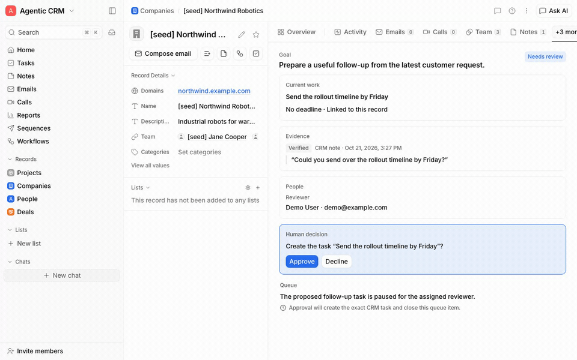
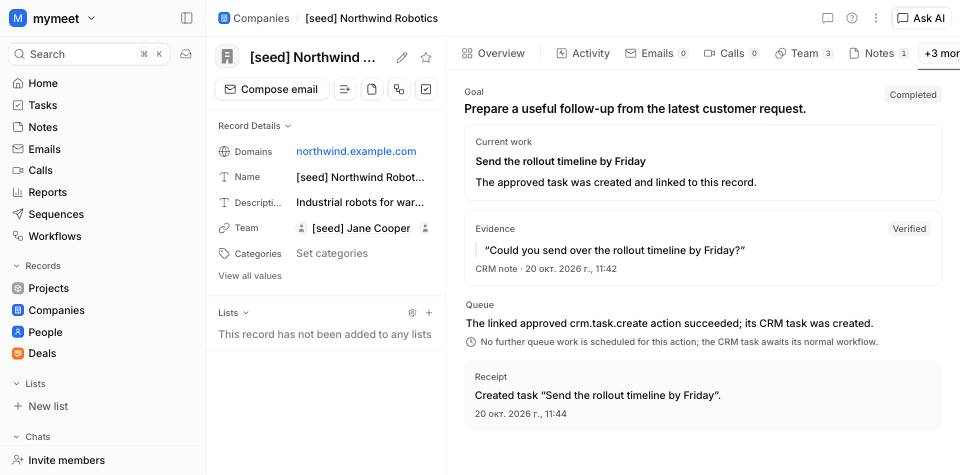
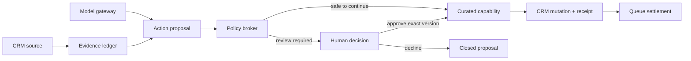

<div align="center">

# Agentic CRM

**A CRM where agents do the work and people keep authority.**

Evidence-backed actions, explicit policy, human review where risk demands it, and a durable receipt for every important change.

[Quickstart](#quickstart) · [Self-hosting](docs/self-hosting.md) · [What works today](#what-works-today) · [Bring your own models](#bring-your-own-models) · [Architecture](#architecture) · [Roadmap](#roadmap)


</div>



Most CRMs add a chat box to a system designed only for humans. Agentic CRM starts from a different contract: people and agents share the same records, capabilities, and audit trail. An agent can propose useful work, but it cannot silently turn uncertain context into customer-facing side effects.

The first complete slice is deliberately small and real:

```text
CRM note → exact evidence → proposed action → policy → human decision
                                                    ↓
                              CRM task ← capability broker → receipt
                                                    ↓
                                              queue settled
```

A seeded customer request becomes an evidence-backed `crm.task.create` proposal. A reviewer sees the source quote and exact change in the record's **Agent** tab, approves or declines it, and receives a persisted execution receipt. Approval rechecks policy, evidence freshness, record access, and proposal version before the task is created.

> **Project status:** early development. The CRM foundation, first supervised agent loop, and Ask routing through saved cloud or paired local models work today. Clean-source export and signed-container automation exist, but image distribution remains blocked by the documented security and license gate. General agent orchestration, richer model-management UI, and installable modules are still in progress.

## Quickstart

This is the source checkout workflow for a local development/demo instance. It runs the app from source and uses Docker Compose only for PostgreSQL and SeaweedFS. For a deployment overview, updates, backups, and recovery, see [Self-hosting](docs/self-hosting.md).

Prerequisites: macOS or Linux, Node.js 24.11 or newer, pnpm 11.11.0 (via Corepack), and Docker with the Compose plugin.

```bash
git clone https://github.com/ilyaberdysh/agentic-crm.git
cd agentic-crm
corepack enable
pnpm install --frozen-lockfile
pnpm db:up
SEED_USERS='demo@example.com:Demo User' SEED_WORKSPACE_SLUG=demo pnpm seed
AGENTIC_CRM_LLM=fake pnpm dev
```

`pnpm seed` applies migrations, creates fictional CRM data, and prints a generated password for a newly created account plus the exact **Agent demo** URL. Open [http://localhost:5173](http://localhost:5173), sign in as `demo@example.com`, and use that URL to review the seeded Northwind Robotics proposal. Keep the generated password private; the seed command does not reveal it again for an existing account.

Click **Approve**. The CRM creates the exact linked task, settles the queue item, and replaces the decision panel with a receipt.

<details>
<summary>See the completed action and receipt</summary>



</details>

The fake model keeps this path credential-free and deterministic. The evidence and proposal are seeded so the demo exercises the trust and execution path, not model quality.

### Self-hosting checks

For the local source workflow above, `pnpm db:up` starts the repository's PostgreSQL and SeaweedFS development services. For an existing deployment, configure its environment and make sure PostgreSQL and the configured S3-compatible endpoint are reachable, then run:

```bash
pnpm doctor
```

The doctor checks the supported Node.js version, required configuration, PostgreSQL connectivity, migration status and checksums, and S3 endpoint reachability. It is read-only: it does not apply migrations, create buckets, or change configuration. It never prints connection strings or secret values. If it reports unapplied migrations, review the database target, run `pnpm db:migrate`, then check again. It is an operator check, not a production-readiness or security audit.

## What works today

### Agentic Core

- **Evidence with provenance.** Exact source fragments, source versions, timestamps, and trust bands are persisted. The first source adapter uses CRM notes.
- **Actions as state machines.** Propose, approve, decline, execute, fail, and receipt transitions are explicit and versioned.
- **Fail-closed policy.** Agent principals have declared capabilities. The first task-create action always requires a human decision, including for verified evidence.
- **Explainable work queue.** Durable leases, concurrent claiming, fencing, recovery primitives, reasons, and next-event explanations are implemented.
- **Capability symmetry.** The same curated `crm.task.create` capability is used by the UI, API, and an MCP-shaped adapter.
- **Agent tab.** Persisted evidence, proposal, reviewer decision, queue state, and receipt appear beside the CRM record where the work matters.
- **Product modules.** A validated `ProductModule` contract declares record and UI surfaces, task types, executable capabilities, connector requirements, migrations, and core compatibility without folding every future feature into the core.

### CRM foundation

This repository already contains a substantial CRM surface: configurable objects and attributes, records, tables and kanban views, notes, tasks, comments, collaborative editing, email and calendar integrations, calls, workflows, sequences, reports, imports and exports, permissions, REST/tRPC APIs, and realtime collaboration.

That breadth is a foundation, not a maturity claim. Agentic Core currently integrates one supervised action deeply rather than pretending every CRM mutation is agent-safe.

## Bring your own models

The destination is one provider contract across API keys, OpenAI-compatible local or cloud endpoints, and subscription-backed CLIs. The current implementation is honest about where each path stands:

| Model path | Current status |
| --- | --- |
| Anthropic API | Wired into the application through server-side `ANTHROPIC_API_KEY`. |
| Deterministic fake | Wired into the application through `AGENTIC_CRM_LLM=fake` for tests and demos. |
| OpenAI-compatible HTTP | Saved cloud connections can be selected for application inference; endpoints are policy-checked and redirects fail closed. A management UI is still pending. |
| Scoped API-key storage | Encrypted connections are resolved only for a scoped invocation, with masked metadata outside the adapter boundary. Verification and management UI are still pending. |
| Local OpenAI-compatible | Requests are dispatched through the standalone enrolled workspace runner rather than letting the hosted API reach arbitrary user URLs. |
| Codex CLI | The standalone runner connects enrollment, isolated auth profiles, scoped grants, authenticated MCP, and the rootless-container sandbox. Authenticated live generation still requires acceptance on the operator's Linux host. |

The full CLI safety boundary and its limitations are documented in [the execution experiment](packages/domain/src/ai/execution/README.md).

## Architecture



The design keeps three boundaries separate:

1. **Models reason.** They may produce suggestions or structured proposals; they do not receive ambient CRM authority.
2. **Policy decides.** The broker evaluates principal, capability, evidence, current access, and risk at execution time.
3. **Capabilities mutate.** Narrow application services perform the side effect and record the outcome.

The monorepo is organized around those boundaries:

| Path | Responsibility |
| --- | --- |
| `apps/web` | React CRM and the record-level Agent experience |
| `apps/api` | Fastify, tRPC, public API, auth, curated agent endpoints |
| `apps/worker` | Background CRM jobs |
| `apps/runner` | Outbound paired runner for local models and sandboxed Codex execution |
| `packages/domain` | CRM services, agentic actions, evidence, queue, model gateway |
| `packages/contracts` | Shared schemas, policy and module contracts |
| `packages/db` | PostgreSQL schema, migrations, RLS, and seed |
| `packages/realtime` | Change feed and collaboration transport |

## Development

```bash
pnpm lint
pnpm typecheck
pnpm test
pnpm build
```

Database-backed suites expect the local Postgres service from `pnpm db:up`. Tests derive checkout-specific database names so parallel worktrees do not destroy each other's suite databases.

Useful project documents:

- [Deferred backlog](docs/agentic-core/backlog.yaml)
- [Implementation task ledger](docs/agentic-core/tasks.yaml)
- [Changelog](CHANGELOG.md)
- [Contribution guide](CONTRIBUTING.md)
- [Code of Conduct](CODE_OF_CONDUCT.md)
- [Security policy](SECURITY.md)
- [Source and asset provenance status](PROVENANCE.md)
- [Clean public-source procedure](docs/publication.md)
- [Container signing and verification](docs/container-images.md)
- [License](LICENSE) and [third-party notice](NOTICE)

## Roadmap

Near-term work is intentionally focused:

- add verification and management UI for saved provider connections;
- complete authenticated Codex acceptance on each supported Linux runner host before sensitive CRM data reaches it;
- run queue claiming and reconciliation in production workers;
- expand the Agent tab from the latest action into a useful record-level work history;
- add more evidence sources and high-value CRM capabilities without weakening the policy boundary.

Ideas that are useful but not ready belong in [`docs/agentic-core/backlog.yaml`](docs/agentic-core/backlog.yaml), not in speculative production code.

## Open-source status

Agentic CRM declares the [Apache License 2.0](LICENSE) and is an early preview candidate, not a production-ready CRM. [PROVENANCE.md](PROVENANCE.md) records the maintainer's authorship and source-use disposition. Expect incomplete setup paths, breaking changes, and security work before the project is suitable for sensitive customer data. Self-hosters should review [the deployment and recovery notes](docs/self-hosting.md) before putting any data into an instance.

Source-level dependency attribution is summarized in [NOTICE](NOTICE). A complete license audit is still required before publishing binary or container distributions that bundle third-party code.

See [CONTRIBUTING.md](CONTRIBUTING.md) before sending changes, follow the [Code of Conduct](CODE_OF_CONDUCT.md), and use [SECURITY.md](SECURITY.md) for vulnerability reports.

For proposed GitHub repository metadata, demo recording instructions, and the social preview source, see [Community launch materials](docs/community-launch.md).
